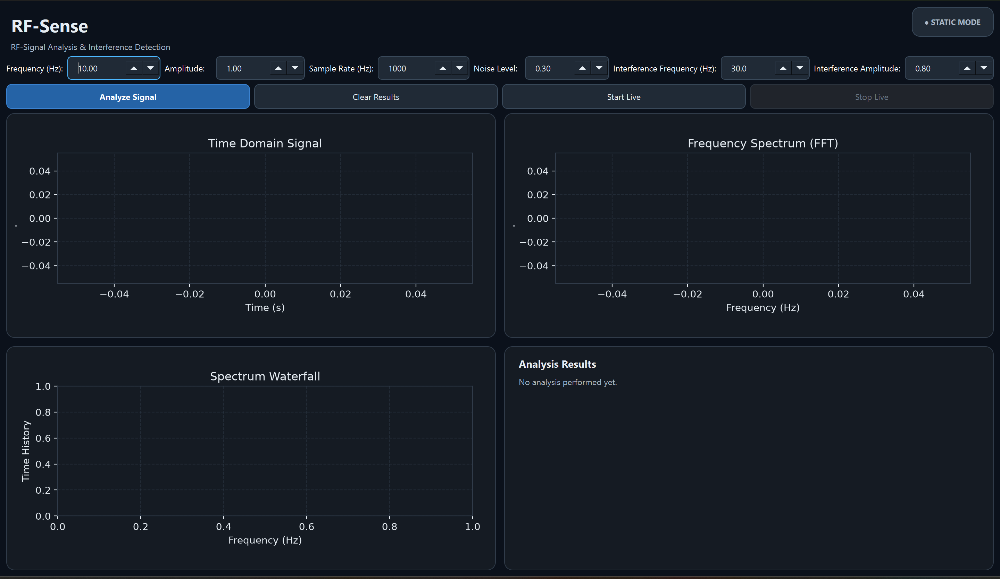

# RF-Sense

**Simulation-Based RF Signal Analysis & Interference Detection**

RF-Sense is a Python-based project designed to simulate, analyze, and detect potential interference in synthetic radio-frequency (RF) signals.

The project explores digital signal processing (DSP), frequency-domain analysis, noise estimation, and interference detection through a modular software architecture.


## Project Objectives

- Generate and visualize synthetic signals with different frequencies and amplitudes.
- Analyze signals in the time and frequency domains using the Fast Fourier Transform (FFT).
- Simulate noise and interfering signals.
- Estimate signal-to-noise ratio (SNR).
- Detect significant frequency peaks using an adaptive threshold.
- Classify detected frequency components as expected signals or potential interference.
- Evaluate detection performance under different signal and noise conditions.


## Technologies

- **Python** - Core programming language and application logic
- **NumPy** - Numerical computations, signal generation, and noise simulation
- **SciPy FFT** - Frequency-domain signal analysis
- **Matplotlib** - Time-domain, FFT spectrum, and waterfall visualizations
- **PyQt6** - Desktop graphical user interface and live simulation controls
- **unittest** - Automated testing and validation
- **Git & GitHub** - Version control and project management


## Current Features

### 1. Signal Generation

Generates synthetic sinusoidal signals with configurable frequencies, amplitudes, sampling rates, and durations.

### 2. Frequency Spectrum Analysis

Uses the Fast Fourier Transform (FFT) to convert time-domain signals into frequency-domain representations and identify frequency components.

### 3. Noise Simulation & SNR Analysis

Adds simulated noise to generated signals and estimates the signal-to-noise ratio (SNR).

### 4. Interference Detection

Detects significant frequency peaks using an adaptive threshold and classifies them as expected signals or potential interference.

### 5. Desktop Graphical User Interface

Provides an interactive PyQt6 dashboard with time-domain, FFT spectrum, waterfall, and analysis results displays.

### 6. Live Simulation Mode

Continuously generates simulated signal data and updates the visualizations and analysis results in real time.

### 7. Testing & Evaluation

Includes automated unit tests and manual GUI validation to verify signal processing, interference detection, and application functionality.

## Application Preview 

The RF-Sense desktop application provides an interactive dashboard for simulated RF signal analysis and interference detection.




## Project Structure

```text
RF-Sense/
|-- gui/
|   `-- main.py
|-- src/
|   |-- signal_generator.py
|   |-- noise_simulator.py
|   |-- spectrum_analyzer.py
|   |-- interference_detector.py
|   `-- evaluation.py
|-- tests/
|   |-- test_evaluation.py
|   `-- test_interference_detector.py
|-- docs/
|-- README.md
|-- requirements.txt
`-- .gitignore
```

### Getting Started


### Installation

1. Clone the repository:

   ```bash
   git clone https://github.com/francessola/RF-Sense.git
   cd RF-Sense
   ```

2. Create a virtual environment:

   ```bash
   python -m venv .venv
   ```

3. Activate the virtual environment (Windows PowerShell):

   ```powershell
   .\.venv\Scripts\Activate.ps1
   ```

4. Install the required dependencies:

   ```bash
   python -m pip install -r requirements.txt
   ```

### Running the Application

Launch the RF-Sense desktop GUI from the project root:

```bash
python gui/main.py
```

The application provides interactive signal analysis, interference detection, and live simulation capabilities using synthetic signals.

### Running Tests

Run the automated unit tests:

```bash
python -m unittest discover -s tests -v
```


